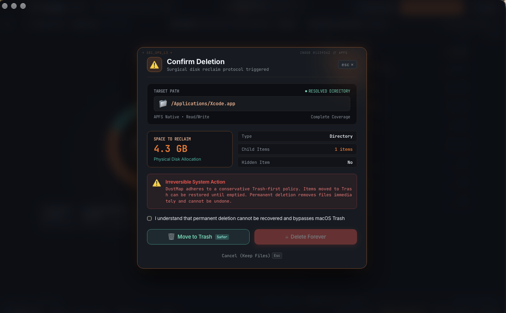

# 🗺️ DustMap

> **Blazing-fast, transparent disk space analyzer and conservative cleaner for macOS.**  
> *See where your disk breathes. Reclaim what you don't need.*

[](LICENSE)
[]()
[]()

DustMap is a free, open-source macOS storage tool built for engineers, power users, and anyone with mysterious "System Data" filling their disk. Built with Rust and Tauri 2, it scans millions of filesystem entries in seconds, renders interactive squarified treemaps, and provides an explainable, safe, Trash-first cleaner.

---

## 📸 Screenshots

### 1. Storage Volume Dashboard
*Telemetry overview displaying allocated vs. free space across APFS containers with zero scanning lag.*


### 2. Donut Sector Breakdown & Top Space Consumers
*Dynamic category arcs, space gauges, and one-click cache purge inspection.*


### 3. Proportional Squarified Treemap
*Visualizing deep folder hierarchies with category coloring and macOS Finder integration.*


---

## 🎯 Key Capabilities

- ⚡ **Blazing Fast Traversal:** Traverses deep file trees using bounded parallel I/O and compact in-memory indexes.
- 📐 **Squarified Treemap:** Visualizes directory sizes proportionally with instant category coloring (Developer, Applications, Caches, Hidden).
- 🔍 **Hidden & System Data Detection:** Uncovers hidden files (`.cache`, `.cargo`, `.npm`, `DerivedData`) and reconciles volume usage.
- 💾 **External Drives & APFS Volumes:** Seamlessly scan and navigate external SSDs, USB drives, and internal APFS containers.
- 🛡️ **Conservative, Trash-First Cleaner:** Every recommendation explains *what* it removes, *why* it is regenerable, and routes to macOS Trash by default.
- 🔒 **Zero Telemetry & Completely Offline:** No analytics, no phone-home, no accounts. 100% auditable open-source code.

---

## 📦 Project Structure

```
dustmap/
├── crates/
│   ├── dustmap-core/        # Traversal engine, compact index, audit log, volumes
│   ├── dustmap-rules/       # TOML rule parser & validator
│   └── dustmap-cli/         # Companion terminal CLI (`dustmap scan`)
├── app/
│   ├── src-tauri/           # Tauri 2 native shell & IPC commands
│   └── src/                 # Svelte 5 + TypeScript + Vite frontend
├── rules/                   # Community-maintained cleanup rules (TOML)
└── fixtures/                # Deterministic test fixtures for rules & engine
```

---

## 🚀 Getting Started

### Prerequisites
- macOS 13 (Ventura) or later
- Rust (`curl --proto '=https' --tlsv1.2 -sSf https://sh.rustup.rs | sh`)
- Bun (`curl -fsSL https://bun.sh/install | bash`)

### Build from Source

```bash
# Build the Rust workspace
cargo build --workspace

# Run CLI scan
cargo run -p dustmap-cli -- scan ~

# Run the desktop app
cd app
bun install
bun run tauri dev
```

---

## 📜 Governance & Contribution

- **License:** [Apache-2.0](LICENSE)
- **Code of Conduct:** [Contributor Covenant 2.1](CODE_OF_CONDUCT.md)
- **Contributing Guide:** [CONTRIBUTING.md](CONTRIBUTING.md)
- **Security & Data-Loss Policy:** [SECURITY.md](SECURITY.md)
