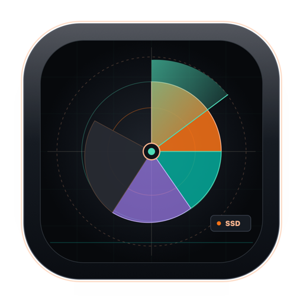
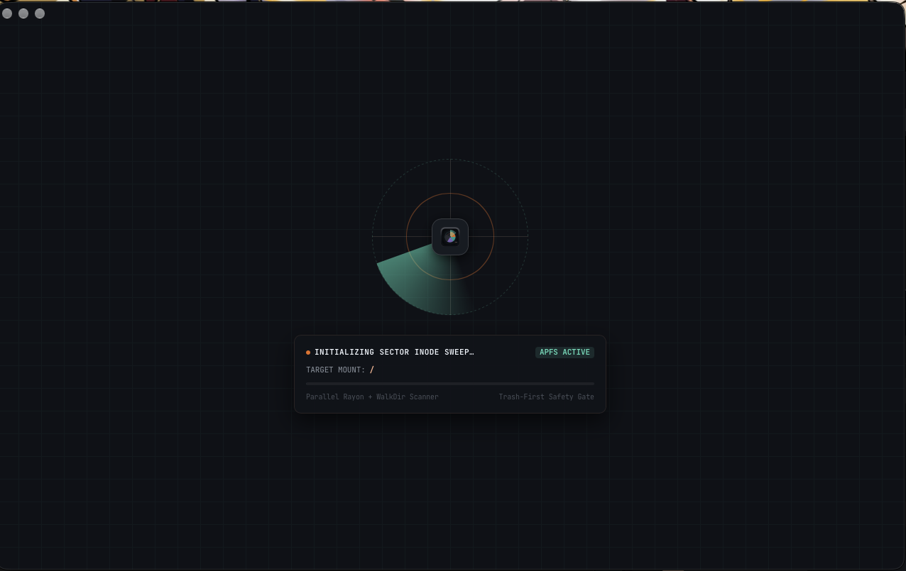
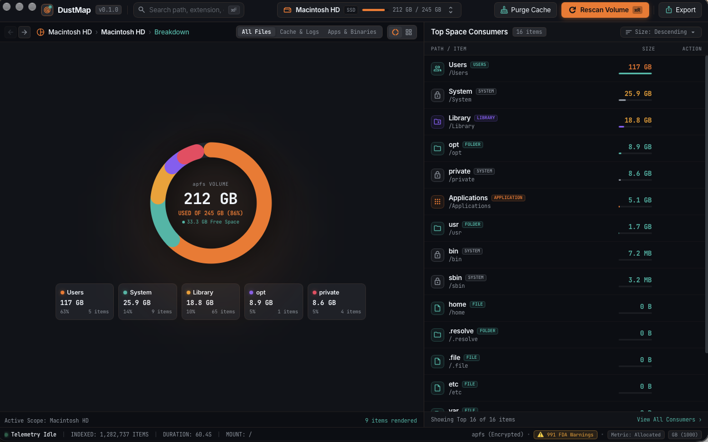

<p align="center">
  
</p>

<h1 align="center">DustMap</h1>

<p align="center">
  <strong>Blazing-fast, transparent disk space analyzer and conservative cleaner for macOS.</strong><br>
  <em>See where your disk breathes. Reclaim what you don't need.</em>
</p>

<p align="center">
  <a href="LICENSE"></a>
  
  
  <a href="docs/ARCHITECTURE.md"></a>
</p>

DustMap is a free, open-source macOS storage tool built for engineers, power users, and anyone with mysterious "System Data" filling their disk. Built with Rust and Tauri 2, it scans millions of filesystem entries in seconds, renders interactive sector donuts and squarified sector maps, and provides an explainable, safe, Trash-first cleaner.

---

## 📸 Screenshots

### 1. Radar Inode Sweep & Fast Initializer HUD
*Real-time radar sweep visualizing concurrent Rayon worker threads indexing filesystem nodes.*


### 2. Obsidian Telemetry Dashboard & Donut Sector Breakdown
*Dynamic category arcs, APFS physical block gauges, and high-density space consumer inspector.*


### 3. Trash-First Safety Gate & Confirm Deletion Protocol
*Surgical disk reclaim modal with two-step verification, safety checks, and macOS Trash routing.*


---

## 🎯 Key Capabilities

- ⚡ **Blazing Fast Traversal:** Traverses deep file trees using bounded parallel I/O and compact in-memory indexes.
- 📐 **Interactive Donut & Squarified Treemap:** Visualizes directory sizes proportionally with instant category coloring (Developer, Applications, Caches, Hidden).
- 🔍 **Hidden & System Data Detection:** Uncovers hidden files (`.cache`, `.cargo`, `.npm`, `DerivedData`) and reconciles volume usage.
- 💾 **Unified Disks Dropdown:** Seamlessly switch between external SSDs, USB drives, and internal APFS containers from a single menu bar dropdown.
- 🛡️ **Conservative, Trash-First Cleaner:** Every recommendation explains *what* it removes, *why* it is regenerable, and routes to macOS Trash by default.
- 🔒 **Zero Telemetry & Completely Offline:** No analytics, no phone-home, no accounts. 100% auditable open-source code.

---

## 🏛️ Architecture & Verification

Detailed system design, memory layout, and security models are documented in [**`docs/ARCHITECTURE.md`**](docs/ARCHITECTURE.md).

- **Core Engine:** Written in pure Rust (`dustmap-core`) with flat memory indexes and $O(N)$ post-order aggregation.
- **Frontend:** Built with Svelte 5 runes (`$state`, `$derived`, `$effect`) and Vite.
- **Verification Suite:** 23 automated quality gates and adversarial tests (`.verify/run.sh`) covering path traversal, SIP protection, and symlink cycle immunity.

---

## 📦 Project Structure

```
dustmap/
├── crates/
│   ├── dustmap-core/        # Traversal engine, compact index, audit log, volumes
│   ├── dustmap-rules/       # TOML rule parser & validator
│   └── dustmap-cli/         # Companion terminal CLI (`dustmap scan`)
├── app/
│   ├── src-tauri/           # Tauri 2 native shell & IPC commands
│   └── src/                 # Svelte 5 + TypeScript + Vite frontend
├── rules/                   # Community-maintained cleanup rules (TOML)
└── fixtures/                # Deterministic test fixtures for rules & engine
```

---

## 🍺 Installation via Homebrew

DustMap can be installed using its official Homebrew tap:

### Desktop Application (GUI)
```bash
brew install --cask abhiudayg/dustmap/dustmap
```

### Standalone Command-Line Tool (CLI)
```bash
brew install abhiudayg/dustmap/dustmap
```

Or tap the repository first:
```bash
brew tap abhiudayg/dustmap
brew install --cask dustmap    # GUI App
brew install dustmap          # CLI Tool
```

---

## 🚀 Getting Started

### Prerequisites
- macOS 13 (Ventura) or later
- Rust (`curl --proto '=https' --tlsv1.2 -sSf https://sh.rustup.rs | sh`)
- Bun (`curl -fsSL https://bun.sh/install | bash`)

### Build from Source

```bash
# Build the Rust workspace
cargo build --workspace

# Run CLI scan
cargo run -p dustmap-cli -- scan ~

# Run the desktop app
cd app
bun install
bun run tauri dev
```

---

## 📜 Governance & Contribution

- **License:** [Apache-2.0](LICENSE)
- **Code of Conduct:** [Contributor Covenant 2.1](CODE_OF_CONDUCT.md)
- **Contributing Guide:** [CONTRIBUTING.md](CONTRIBUTING.md)
- **Security & Data-Loss Policy:** [SECURITY.md](SECURITY.md)
